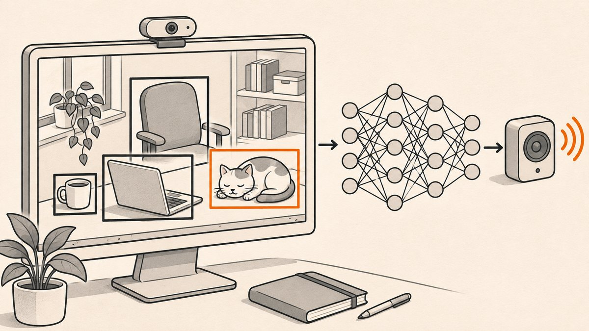

<p align="center"></p>

# YOLO Realtime Object Detection

Real-time object detection on a webcam feed with YOLOv3 and the OpenCV DNN module, with each detected object name spoken aloud.

## What it does

- Reads frames from the default webcam.
- Detects the 80 COCO object classes with a YOLOv3 Darknet model.
- Draws a bounding box, class name and confidence for each detection.
- Prints each detected label and speaks it using Google Text-to-Speech.
- Press Esc to quit.

## How it works

`Object_Detection.py` loads `yolov3.weights` and `yolov3.cfg` with `cv2.dnn.readNet` and the class names from `coco.names`. Each frame is turned into a 416x416 blob (scaled by 1/255, RGB), passed through the network, and every output row with a class score above 0.5 becomes a candidate box. `cv2.dnn.NMSBoxes` (score threshold 0.5, NMS threshold 0.4) removes overlapping boxes. For every kept box the label is converted to speech with `gTTS`, saved as `output.mp3`, played with `playsound`, and deleted.

## Tech

- Python 3
- OpenCV (`cv2.dnn`) running YOLOv3 (Darknet format)
- NumPy
- gTTS and playsound for spoken labels

## Run it

Needs a webcam and an internet connection (gTTS calls Google's TTS service).

```bash
pip install opencv-python numpy gTTS playsound
```

Download the YOLOv3 files from the official Darknet sources and put them next to `Object_Detection.py`:

- `yolov3.cfg`
- `yolov3.weights`
- `coco.names`

Then run:

```bash
python Object_Detection.py
```

## Project structure

- `Object_Detection.py`: model loading, detection loop, drawing and speech output.
- `README.md`: this file.

## Notes

- The model files and `coco.names` are not in the repository; the script fails at startup without them.
- Speech is generated and played synchronously for every detection in every frame, followed by a 1 second sleep, so the video freezes while labels are spoken. Remove the gTTS block for smooth real-time display.
- Detection runs on the CPU through OpenCV DNN; no GPU backend is configured.
- A commented-out line shows an alternative IP camera source.
